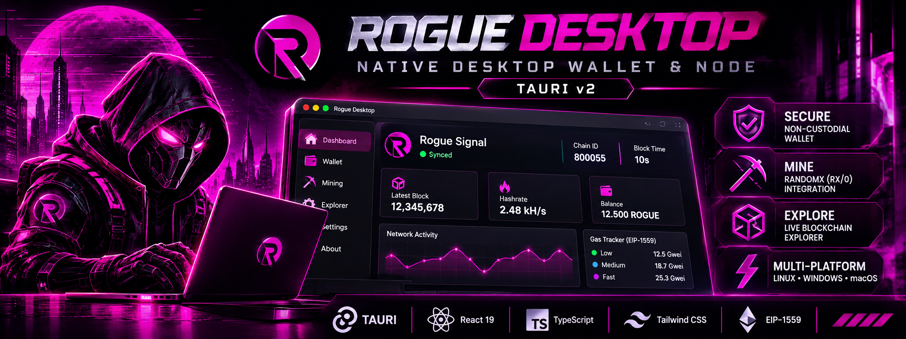
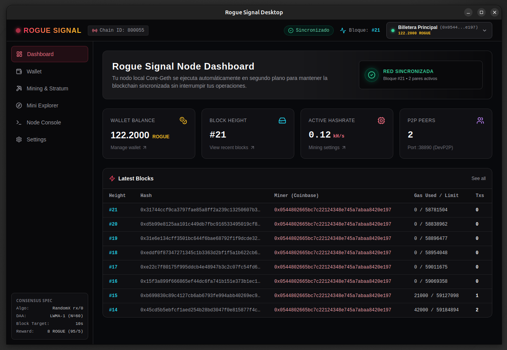

# Rogue Signal Desktop (Tauri v2 + React 19)






**Rogue Signal Desktop** is the official all-in-one desktop client, node manager, and non-custodial wallet for the **Rogue Signal (ROGUE)** blockchain (Chain ID: `800055`).

Built with **Tauri v2**, **Rust**, **React 19**, **TypeScript**, and **Tailwind CSS**, it combines lightweight native performance with an advanced cyberpunk interface.

---

## 🚀 Key Features

* **Dual Connection Architecture (Hybrid Mode)**:
  * **Managed Local Node (Sidecar)**: Supervise, start, and stop the local `geth --rogue` node process with real-time log streaming (`stdout`/`stderr`).
  * **Remote RPC Mode**: Connect seamlessly to any external Rogue Signal node via standard JSON-RPC HTTP (`:38845`) and WebSocket (`:38846`).
* **Non-Custodial Cryptographic Keystore (Rust Core)**:
  * Hierarchical Deterministic (HD) key derivation conforming to **BIP-39** (12-word seed phrases) and **BIP-44** standard EVM path:
    $$\text{Derivation Path} = m/44'/60'/0'/0/x$$
  * Military-grade local vault encryption using **Argon2id** password-based key derivation function (KDF) and **AES-256-GCM** authenticated symmetric encryption.
  * Local offline signing for EVM EIP-155 transactions (`secp256k1` recoverable signatures with Chain ID `800055`).
* **Egalitarian Home CPU Mining Control Center**:
  * **Internal Solo CPU Miner**: Toggle internal multithreaded RandomX sealing directly from the UI with real-time thread presets (**25% Low Impact**, **50% Balanced**, **75% High Power**) and manual slider control.
  * **Interactive System Resource Diagnostics**: Built-in hardware inspector (`get_system_specs`) detecting logical CPU cores, total RAM, and available RAM to recommend safe mining parameters.
  * **Memory Profiles**: Defaults strictly to **Light Mode** (~256 MB RAM cache, safe for all home computers) with optional **Fast Mode** (~2.08 GB dataset for high-RAM machines).
  * **Automatic Etherbase Synchronization**: Automatically routes **23.75 ROGUE** miner block rewards (95% of 25 ROGUE + 100% of block transaction fees) to the active wallet address.
* **Gas Estimation & Transaction Engine**:
  * Dynamic fee calculations (**Slow**, **Normal**, **Fast**) adhering to Rogue Signal's 60M block gas limit, `1 Gwei` mempool floor, and 30s target block time.
  * Real-time balance and gas tracking in native ROGUE (18 decimals).
* **Mini On-Chain Explorer & Consensus Telemetry**:
  * Live monitoring of recent blocks, LWMA-1 difficulty adjustments, miner coinbase payouts, RandomX epoch status (`randomx_getEpochInfo`), and active Anti-51% finality (`MaxReorgDepth = 90` + `ECBP-1100 MESS`).
* **Protocol Gamification & Cyberpunk Miner Identity**:
  * Deterministic procedural avatars generated 100% offline via `@dicebear/core` and `@dicebear/collection` seeded by the active wallet address.
  * Interactive miner card querying the on-chain `RogueMinerReputation` system contract (`0x0000000000000000000000000000000000000020`) via `viem` (`eth_call`): renders real-time cyberpunk medals, localized rank badges, current XP, and next-tier progress bar.
  * Native tracking of all 7 on-chain tiers persisted in `StateDB` from Block 0 under contract `0x0000000000000000000000000000000000000020`.
  * Comprehensive i18n localization (English, Spanish, Chinese) with selector flags from `country-flag-icons`.
* **Security, RPC Lockdown & Inactivity Auto-Lock**:
  * Restricts local node HTTP/WS CORS exclusively to `tauri://localhost` and `127.0.0.1:1420` (with `personal` RPC disabled).
  * Configurable auto-lock timers (5, 15, or 30 minutes) clearing decrypted secrets from RAM upon user inactivity.

---

## 🛠️ Binary Provisioning & Resolution

The application automatically resolves the local node binary with zero configuration:

1. **Adjacent Build Directory**: Resolves `../rogue-core-chain/build/bin/geth`.
2. **Workspace Root**: Resolves `rogue-core-chain/build/bin/geth`.
3. **System PATH**: Falls back to global `geth` if installed system-wide.

To build the node binary from source before launching the client:
```bash
cd ../rogue-core-chain
make core-rogue
```

---

## 🔐 Keystore Architecture & Cryptographic Security

Private keys are never stored in plaintext or exposed to the JavaScript frontend. The keystore is isolated within the compiled Rust backend:

```
[Master Password] ---> Argon2id (Salt, Memory=64MB, Iterations=3) ---> 256-bit Key
                                                                           |
[BIP-39 Mnemonic] ---> JSON Payload ---> AES-256-GCM (12-byte Nonce) <------+
                                              |
                                     [.rogue-wallet.vault]
```

### Key Derivation Specifications:
* **Mnemonic**: 128-bit entropy generating 12 English words (BIP-39).
* **Master Seed**: 512-bit HMAC-SHA512 seed.
* **Account 0 Path**: `m/44'/60'/0'/0/0` (Standard Ethereum compatible).
* **Public Key to Address**: Keccak-256 hash of the uncompressed 64-byte public key (last 20 bytes with `0x` prefix).

---

## ⛏️ Home CPU Solo Mining Workflow

```
+-----------------------------------------------------------------------+
|                         Rogue Signal Desktop                          |
|                                                                       |
|  [Hardware Inspector] ---> Detects CPU Cores & Free RAM               |
|  [CPU Miner Control]  ---> RPC miner_setEtherbase / miner_start       |
|                                     |                                 |
|                                     v                                 |
|                   [Core-Rogue Node: RandomX rx/0]                     |
|                   (Default: Light Mode ~256 MB RAM)                   |
+-----------------------------------------------------------------------+
```

---

## 🎖️ Cyberpunk Miner Tiers & Medals Showcase

The desktop client renders real-time cyberpunk medals and localized rank titles queried directly from the `RogueMinerReputation` system contract (`0x0000000000000000000000000000000000000020`) via `getMinerStats(address, lang)` and `getAllRanks(lang)`:

| Level | Rank Title | Blocks Mined | Target XP | Badge Asset | Tier Status |
| :---: | :--- | :---: | :---: | :---: | :---: |
| **Lv.0** | **Unranked Runner** | `0` | `1` | `lvl0.png` | `Standard` |
| **Lv.1** | **Recon Runner** | `1 – 24` | `25` | `lvl1.png` | `Standard` |
| **Lv.2** | **Signal Scraper** | `25 – 99` | `100` | `lvl2.png` | `Elevated` |
| **Lv.3** | **Hash Warden** | `100 – 499` | `500` | `lvl3.png` | `Hardened` |
| **Lv.4** | **Cipher Architect** | `500 – 2,499` | `2,500` | `lvl4.png` | `Elite` |
| **Lv.5** | **Apex Operator** | `2,500 – 9,999` | `10,000` | `lvl5.png` | `Master` |
| **Lv.6** | **Rogue Singularity** | `10,000+` | `MAX` | `lvl6.png` | `Legendary` |

---

## 💸 EIP-1559 Transaction Fees

Rogue Signal executes EVM Cancun contracts and enforces EIP-1559 base fee burning. The client calculates gas parameters according to network conditions:
* **Base Fee**: Dynamically queried from the latest block header.
* **Priority Fee (Miner Tip)**:
  * **Slow**: $1 \text{ Gwei}$ ($\approx 20\text{s}$)
  * **Normal**: $2 \text{ Gwei}$ ($\approx 10\text{s}$)
  * **Fast**: $5 \text{ Gwei}$ ($< 10\text{s}$)
* **Total Max Fee**: $\text{Base Fee} \times 2 + \text{Priority Fee}$.

---

## 💻 Development & Building

### Prerequisites
* **Rust**: `rustc >= 1.75` and `cargo`
* **Node.js**: `node >= 18` and `npm >= 9`
* **Webkit2GTK & Build Tools** (on Debian/Ubuntu):
  ```bash
  sudo apt install libwebkit2gtk-4.1-dev build-essential curl wget file libssl-dev libayatana-appindicator3-dev librsvg2-dev
  ```

### Development Mode
```bash
npm run dev          # Run frontend in Vite dev server (port 1420)
npm run tauri dev    # Launch full Tauri v2 desktop application with live reload
```

### Production Release
To compile native release binaries and installers (`.deb`, `.AppImage`):
```bash
npm run tauri build
```
Binaries will be output to `src-tauri/target/release/bundle/`.

